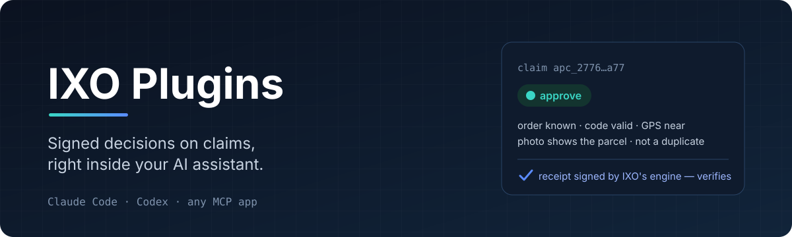
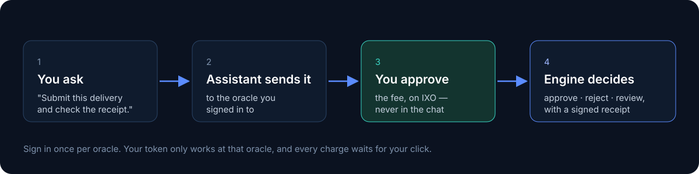

<p align="center">
  
</p>

<p align="center">
  <a href="https://github.com/ixoworld/ixo-plugins/actions/workflows/validate.yml"></a>
  
  
  
</p>

IXO plugins put IXO's services inside your AI assistant, in Claude Code, Codex, Claude.ai, Claude
Desktop and ChatGPT. You say what you want in plain words; the assistant does it, asks you before
anything costs money, and comes back with something you can check.

There are three kinds, and more will come:

- **Oracles** give signed decisions on claims. *"Yes, this parcel was delivered"*, checked against a
  published set of rules and signed by IXO's decision engine, so anyone can verify it later.
  [Read more](docs/kinds/oracle.md).
- **Memory** is your IXO Companion's memory, in whichever app you use: ask it to remember something
  and it's there next time. `ixo-memory` is mainnet; `ixo-memory-testnet` and `ixo-memory-devnet`
  are for testing. [Read more](docs/kinds/memory.md).
- **Openhands** finds paid work, posts asks, and hires people and agents on the Openhands Network.
  Runs on your machine with a key of its own, or as a read-only hosted connector.
  [Read more](docs/kinds/openhands.md).
- **Openhands HQ** sets a company up on Openhands: an organisation, a way to pay workers, an oracle
  and a first ask, with Claude running every step (draft). [Read more](docs/kinds/openhands-hq.md).

<p align="center">
  
</p>

## Plugins

<!-- plugins:start -->
| Plugin | Kind | Runs | What it does |
| --- | --- | --- | --- |
| [`ixo-memory`](plugins/ixo-memory/README.md) | memory | hosted, memory-engine.ixo.earth | Your IXO Companion's memory — remember, recall and import what matters, with your IXO sign-in. |
| [`ixo-memory-devnet`](plugins/ixo-memory-devnet/README.md) | memory | hosted, memory-engine.devnet.ixo.earth | Your IXO Companion's memory — remember, recall and import what matters, with your IXO sign-in. Devnet (test network). |
| [`ixo-memory-testnet`](plugins/ixo-memory-testnet/README.md) | memory | hosted, memory-engine.testnet.ixo.earth | Your IXO Companion's memory — remember, recall and import what matters, with your IXO sign-in. Testnet (test network). |
| [`ixo-openhands`](plugins/ixo-openhands/README.md) | openhands | local, `npx @ixo/openhands-mcp@1` (mainnet) | Find paid work, post asks and hire people and agents on Openhands Network, with your own key held on your machine. |
| [`ixo-openhands-hq`](plugins/ixo-openhands-hq/README.md) | openhands-hq | local, `npx @ixo/openhands-mcp@1` (testnet) | Openhands HQ: set up your company on Openhands — an organisation on chain, a way to pay workers, an oracle and a first ask, with Claude doing every step and telling you exactly what to click. |
| [`ixo-openhands-mainnet`](plugins/ixo-openhands-mainnet/README.md) | openhands-hosted | hosted, openhands.network | Read the open asks on the Openhands Network and see how it works, read-only: Openhands Network (mainnet) needs no sign-in and nothing installed. |
| [`ixo-openhands-testnet`](plugins/ixo-openhands-testnet/README.md) | openhands-hosted | hosted, test.openhands.network | Read the open asks on the Openhands Network and see how it works, read-only: Openhands Network (testnet) needs no sign-in and nothing installed. |
| [`ixo-swiftdrop-devnet`](plugins/ixo-swiftdrop-devnet/README.md) | oracle | hosted, shipment-delivery-oracle.devnet.ixo.earth | Proof of delivery for SwiftDrop Express couriers, decided by IXO's independent engine — devnet (test network). |
<!-- plugins:end -->

The table is generated from the catalog. Each plugin has its own README under
[`plugins/`](plugins). One plugin per service and per network: a sign-in for one service only ever
works at that service, so you install only the ones you use.

## Install

Add the marketplace once, then install the plugins you want.

**Claude Code**

```text
/plugin marketplace add ixoworld/ixo-plugins
/plugin install <plugin-name>@ixo-plugins
```

For example `/plugin install ixo-swiftdrop-devnet@ixo-plugins` or `/plugin install ixo-memory@ixo-plugins`. On Claude Code 2.1.275 or newer
it is one step, with no separate marketplace add: `/plugin install ixo-swiftdrop-devnet --marketplace ixoworld/ixo-plugins`. Plugins that sign in with IXO: run
`/mcp`, pick the plugin's server and choose **Authenticate**. A local plugin such as
`ixo-openhands` needs [Node.js](https://nodejs.org) 22.6 or newer and nothing else, and starts on testnet (play money); see [docs/kinds/openhands.md](docs/kinds/openhands.md#choosing-the-network) for mainnet.

**Codex**

```bash
codex plugin marketplace add ixoworld/ixo-plugins
codex plugin add <plugin-name>@ixo-plugins
```

Plugins that sign in with IXO ask you to sign in when you install. If they don't, run `codex mcp
list` and `codex mcp login` with the plugin's server name (for example `ixo-shipment-delivery` or
`ixo-memory`; the memory plugins' server names match their plugin names).

**Claude.ai, Claude Desktop, ChatGPT**

You don't need a plugin there. Add a hosted plugin's MCP URL as a custom connector. In Claude it's
*Settings → Connectors → Add custom connector*; in ChatGPT it's *Settings → Apps & Connectors* in
developer mode (on a Pro plan, developer mode only runs the read tools). For example:

```text
https://shipment-delivery-oracle.devnet.ixo.earth/v1/mcp
https://memory-engine.ixo.earth/v1/mcp
https://memory-engine.testnet.ixo.earth/v1/mcp
https://memory-engine.devnet.ixo.earth/v1/mcp
https://openhands.network/v1/mcp
```

Plugins that run a local command (`ixo-openhands`) can't run in those apps; use their hosted
read-only connector there. See [docs/clients.md](docs/clients.md) for what each app supports.

## Update

When we ship a new version, update the marketplace and reconnect:

- **Claude Code:** `/plugin marketplace update ixo-plugins`, then reconnect the server in `/mcp`.
- **Codex:** `codex plugin marketplace upgrade ixo-plugins`, then start a new session.
- **Connectors:** nothing to update. The service itself changes.

Releases are the merge of `develop` into `main`; every changed plugin carries a new version.

## How it works

A plugin is a small package: skills that teach the assistant how to use a service well, and a
pointer to that service's MCP server. Nothing else, and never a key. A **hosted** plugin points at
a URL and signs you in with IXO ([docs/sign-in.md](docs/sign-in.md)). A **local** plugin points at
a command your app starts, and that program keeps its own key on your machine.

The plugins are generated: each is built from its kind's template in [`template/`](template) and
listed in both catalogs ([`.claude-plugin/marketplace.json`](.claude-plugin/marketplace.json) for
Claude Code, [`.agents/plugins/marketplace.json`](.agents/plugins/marketplace.json) for Codex), and
CI rebuilds every plugin to check nothing drifted. To add one, see
[CONTRIBUTING.md](CONTRIBUTING.md).

## Docs

- [Oracles](docs/kinds/oracle.md): signed decisions, your money and your call, what the tools do.
- [IXO Memory](docs/kinds/memory.md): what you allow, what it can remember and forget.
- [Openhands Network](docs/kinds/openhands.md): the key, the network, hosted versus local.
- [Openhands HQ](docs/kinds/openhands-hq.md): company onboarding, the three ways to pay, secrets.
- [Clients](docs/clients.md): plugin, connector or local command, per app.
- [Signing in](docs/sign-in.md): IXO sign-in for hosted plugins, a key for local ones.
- [Contributing](CONTRIBUTING.md): add a plugin or a kind, versioning, CI.


## License

The plugins are free to install and use with your AI assistant. Everything else in this repository
is IXO's — please don't copy, modify or redistribute it. See [LICENSE](LICENSE).

## Security

Found something? Please report it privately — see [SECURITY.md](SECURITY.md).

---

<p align="center"><sub>Made by <a href="https://ixo.world">IXO</a>. Oracles don't decide anything themselves — IXO's decision engine does, against each protocol's published rules, and signs every result.</sub></p>
