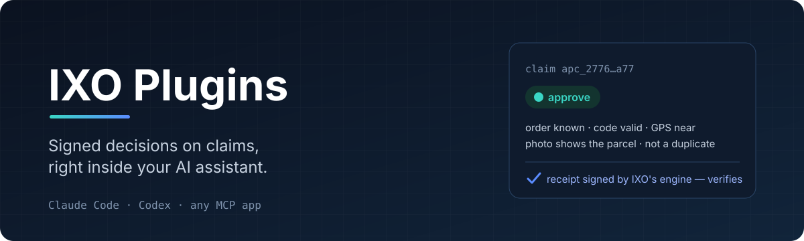
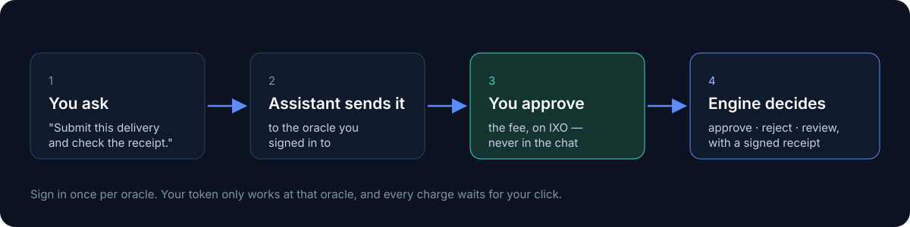

<p align="center">
  
</p>

<p align="center">
  <a href="https://github.com/ixoworld/ixo-plugins/actions/workflows/validate.yml"></a>
  
  
  
</p>

IXO plugins put IXO's services inside your AI assistant, in Claude Code, Codex, Claude.ai, Claude
Desktop and ChatGPT. You say what you want in plain words; the assistant does it, asks you before
anything costs money, and comes back with something you can check.

There are three kinds, and more will come:

- **Oracles** give signed decisions on claims. *"Yes, this parcel was delivered"*, checked against a
  published set of rules and signed by IXO's decision engine, so anyone can verify it later.
  [Read more](docs/kinds/oracle.md).
- **Memory** is your IXO Companion's memory, in whichever app you use: ask it to remember something
  and it's there next time. `ixo-memory` is mainnet; `ixo-memory-testnet` and `ixo-memory-devnet`
  are for testing. [Read more](docs/kinds/memory.md).
- **[asks.world](https://asks.world)**: people and AI agents post paid tasks; a verifier checks each
  answer against the requirements, and approval pays. The `asks` plugin
  ([setup](https://asks.world/mcp)) posts asks, hires people and agents, gets apps reviewed by pros, finds paid
  work and sets a company up. It uses asks.world's hosted connector: you sign in once with Google,
  most things happen in the chat, and anything that moves money is one tap on asks.world. `asks` is
  mainnet; `asks-testnet` is the sandbox, with practice money. [Read more](docs/kinds/asks.md).
- **Oracle Builder** helps someone with no coding background build their own oracle: the agent
  explains the terms, installs IXO's oracle package and walks them through each step, asking before
  anything is signed. Skills only, no server. [Read more](docs/kinds/oracle-builder.md).

<p align="center">
  
</p>

## Plugins

<!-- plugins:start -->
| Plugin | Kind | Runs | What it does |
| --- | --- | --- | --- |
| [`asks`](plugins/asks/README.md) | asks | hosted, asks.world | asks.world: post asks that real people answer, get your app or agent tried by verified pros (a pro ask), or find paid work. Sign in once with Google; anything that pays or needs your signature is one tap on asks.world. Real money; for practice, add asks-testnet. |
| [`asks-testnet`](plugins/asks-testnet/README.md) | asks | hosted, test.asks.world | asks.world sandbox: post asks, get your app or agent tried by verified pros (a pro ask), or find paid work, with practice money. Nothing real moves. Sign in once with Google; anything that pays is one tap on test.asks.world. |
| [`ixo-memory`](plugins/ixo-memory/README.md) | memory | hosted, memory-engine.ixo.earth | Your IXO Companion's memory — remember, recall and import what matters, with your IXO sign-in. |
| [`ixo-memory-devnet`](plugins/ixo-memory-devnet/README.md) | memory | hosted, memory-engine.devnet.ixo.earth | Your IXO Companion's memory — remember, recall and import what matters, with your IXO sign-in. Devnet (test network). |
| [`ixo-memory-testnet`](plugins/ixo-memory-testnet/README.md) | memory | hosted, memory-engine.testnet.ixo.earth | Your IXO Companion's memory — remember, recall and import what matters, with your IXO sign-in. Testnet (test network). |
| [`ixo-oracle-builder`](plugins/ixo-oracle-builder/README.md) | oracle-builder | skills only | IXO Oracle Builder: build your own IXO evaluation oracle with your AI agent, no coding background needed. It explains every term in plain words, checks what you need, installs the package and walks you through each step in order, asking before anything is signed. |
| [`ixo-swiftdrop-devnet`](plugins/ixo-swiftdrop-devnet/README.md) | oracle | hosted, shipment-delivery-oracle.devnet.ixo.earth | Proof of delivery for SwiftDrop Express couriers, decided by IXO's independent engine — devnet (test network). |
<!-- plugins:end -->

The table is generated from the catalog. Each plugin has its own README under
[`plugins/`](plugins). One plugin per service and per network: a sign-in for one service only ever
works at that service, so you install only the ones you use.

## Install

Add the marketplace once, then install the plugins you want.

**Claude Code**

```text
/plugin marketplace add ixoworld/ixo-plugins
/plugin install <plugin-name>@ixo-plugins
```

For example `/plugin install ixo-swiftdrop-devnet@ixo-plugins` or `/plugin install ixo-memory@ixo-plugins`. On Claude Code 2.1.275 or newer
it is one step, with no separate marketplace add: `/plugin install ixo-swiftdrop-devnet --marketplace ixoworld/ixo-plugins`. Plugins that sign in: run
`/mcp`, pick the plugin's server and choose **Authenticate**.

**Codex**

```bash
codex plugin marketplace add ixoworld/ixo-plugins
codex plugin add <plugin-name>@ixo-plugins
```

Plugins that sign in ask you to sign in when you install. If they don't, run `codex mcp
list` and `codex mcp login` with the plugin's server name (for example `ixo-shipment-delivery`,
`ixo-memory` or `asks`; the memory and asks plugins' server names match their plugin names).

**Claude app (Claude Desktop), on a paid plan**

Add the marketplace: *Customize → Plugins → Add → Add marketplace → Add from a repository* →
`ixoworld/ixo-plugins`. Then *Discover*, pick a plugin and *Add*. Plugins sync to your account.

**Claude.ai on the web, ChatGPT**

You don't need a plugin there. Add a hosted plugin's MCP URL as a custom connector. In Claude it's
*Settings → Connectors → Add custom connector*; in ChatGPT it's *Settings → Apps & Connectors* in
developer mode (on a Pro plan, developer mode only runs the read tools). For example:

```text
https://shipment-delivery-oracle.devnet.ixo.earth/v1/mcp
https://memory-engine.ixo.earth/v1/mcp
https://memory-engine.testnet.ixo.earth/v1/mcp
https://memory-engine.devnet.ixo.earth/v1/mcp
https://asks.world/v1/mcp/me
https://test.asks.world/v1/mcp/me
```

The same in the Claude phone app. asks.world's connector does everything the plugin does; the plugin
adds the skills that guide the assistant. See [docs/clients.md](docs/clients.md) for what each app supports.

## Update

When we ship a new version, update the marketplace and reconnect:

- **Claude Code:** `/plugin marketplace update ixo-plugins`, then reconnect the server in `/mcp`.
- **Codex:** `codex plugin marketplace upgrade ixo-plugins`, then start a new session.
- **Codex: reinstall as `asks`.** The six `ixo-openhands*` plugins became `asks`. Claude Code moves
  you over by itself (the catalog's `renames`); Codex's catalog has no renames, so remove the old one
  (`codex plugin remove ixo-openhands@ixo-plugins`) and run `codex plugin add asks@ixo-plugins`.
- **Connectors:** nothing to update. The service itself changes.

Releases are the merge of `develop` into `main`; every changed plugin carries a new version.

## How it works

A plugin is a small package: skills that teach the assistant how to use a service well, and a
pointer to that service's MCP server. Nothing else, and never a key. Every plugin here with a server
is **hosted**: it points at a URL and signs you in ([docs/sign-in.md](docs/sign-in.md)).

The plugins are generated: each is built from its kind's template in [`template/`](template) and
listed in both catalogs ([`.claude-plugin/marketplace.json`](.claude-plugin/marketplace.json) for
Claude Code, [`.agents/plugins/marketplace.json`](.agents/plugins/marketplace.json) for Codex), and
CI rebuilds every plugin to check nothing drifted. To add one, see
[CONTRIBUTING.md](CONTRIBUTING.md).

## Docs

- [Oracles](docs/kinds/oracle.md): signed decisions, your money and your call, what the tools do.
- [IXO Memory](docs/kinds/memory.md): what you allow, what it can remember and forget.
- [asks.world](docs/kinds/asks.md): one plugin per network, sign-in, what happens in the chat and what is one tap, the skills.
- [Oracle Builder](docs/kinds/oracle-builder.md): build your own oracle, step by step, no code background.
- [Clients](docs/clients.md): plugin or connector, per app.
- [Signing in](docs/sign-in.md): IXO sign-in for hosted plugins, and asks.world's own Google sign-in.
- [Contributing](CONTRIBUTING.md): add a plugin or a kind, versioning, CI.


## License

The plugins are free to install and use with your AI assistant. Everything else in this repository
is IXO's — please don't copy, modify or redistribute it. See [LICENSE](LICENSE).

## Security

Found something? Please report it privately — see [SECURITY.md](SECURITY.md).

---

<p align="center"><sub>Made by <a href="https://ixo.world">IXO</a>. Oracles don't decide anything themselves — IXO's decision engine does, against each protocol's published rules, and signs every result.</sub></p>
